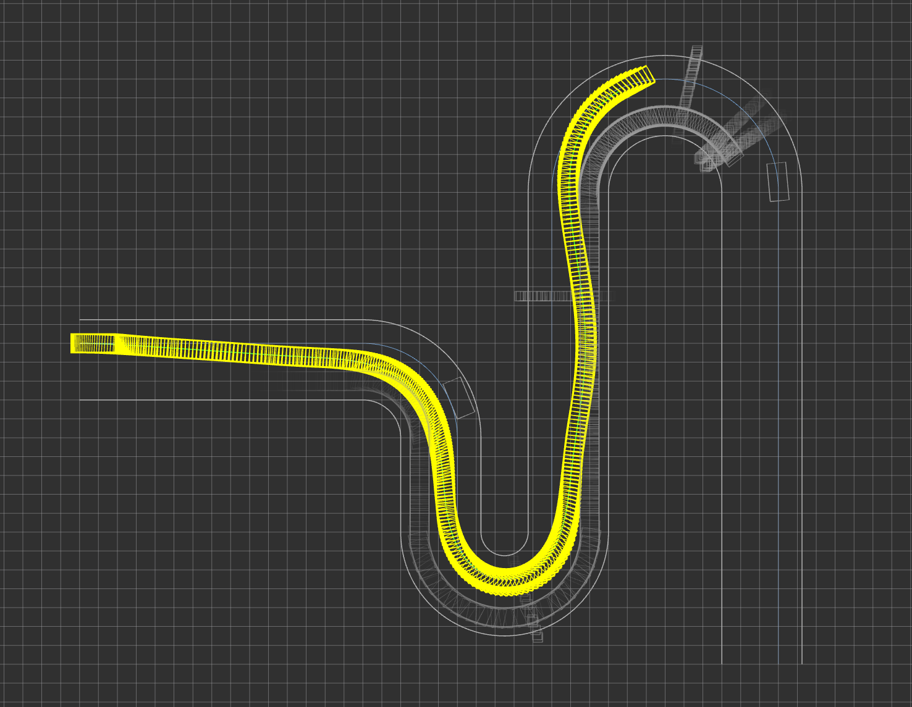

# Cartesian trajectory planning on curvy roads

[Download ZIP](https://github.com/libai1943/CartesianPlanner/archive/refs/heads/main.zip) · [Getting started](#build-and-run-the-recorded-scene) · [Guide](#from-a-road-reference-to-a-timed-trajectory) · [Citation](#citation)

A vehicle rounding a bend must account for its full footprint, the road edges and where other road users will be when it arrives. This ROS 1 package uses the road reference to search for an initial trajectory, then refines the vehicle's motion in Cartesian coordinates. Watch the two stages in RViz or call the C++ planner directly. [IEEE T-ITS paper](https://doi.org/10.1109/TITS.2022.3145389) · [Demo video](https://user-images.githubusercontent.com/85840949/150943617-f949d10d-c1be-424f-9530-1a21a5c67eef.mp4)



## Build and run the recorded scene

Use a Linux ROS 1/catkin environment with RViz, Python 3 and ROS Python message packages, a C++11 compiler, CMake, LAPACK and METIS. The random scenario generator also imports NumPy. The build downloads CasADi **3.6.3** and builds it with IPOPT, so the first build needs network access. In a shell with your ROS environment sourced:

```bash
sudo apt-get install gcc g++ gfortran git patch wget pkg-config liblapack-dev libmetis-dev
mkdir -p ~/catkin_ws/src
cd ~/catkin_ws/src
git clone https://github.com/libai1943/CartesianPlanner.git cartesian_planner
cd ~/catkin_ws
catkin_make -DWITH_HSL=OFF
source devel/setup.bash
roslaunch cartesian_planner pedestrian_test.launch
```

The launch file loads [the saved scene](script/example.pickle), starts the planner and opens RViz. Choose **2D Nav Goal** and click in the view to trigger a solve. The click sends the trigger message. The demo starts from the state set in the node, including an initial speed of 5 m/s. Watch the cyan coarse path, intermediate iterations and the speed-colored optimized path. Playback advances the obstacle footprints at the corresponding trajectory times.

For a new random scene, run `roslaunch cartesian_planner random_pedestrian_test.launch` after stopping the previous launch. To replay your own compatible saved scene, pass `file:=/absolute/path/to/scene.pickle` to `pedestrian_test.launch`.

## From a road reference to a timed trajectory

| Stage | Source | Input and result |
| --- | --- | --- |
| Receive the scene | [CartesianPlannerNode](src/cartesian_planner_node.cpp) | `/center_line` carries the road reference and left/right bounds. `/obstacles` supplies static polygons. `/dynamic_obstacles` supplies footprints with timed poses. |
| Search for a seed | [DP planner](src/cartesian_planner/dp_planner.cpp) | Sample along and across the reference. Weigh obstacle costs, deviation, progress and changes in lateral or longitudinal motion. Output a coarse trajectory. |
| Initialize the states | [CalculateInitialGuess](src/cartesian_planner/trajectory_optimizer.cpp) | Use the seed's positions and headings to estimate speed, steering angle and control histories. |
| Construct corridors | [FormulateCorridorConstraints and GenerateBox](src/cartesian_planner/trajectory_optimizer.cpp) | Expand axis-aligned boxes around the front and rear covering discs. Query the environment at the time associated with each sample. |
| Refine the trajectory | [Trajectory NLP](src/cartesian_planner/trajectory_nlp.cpp) | Penalize reference deviation, control effort and nonlinear motion residuals. Rebuild corridors and increase the dynamics penalty if the residual is still above tolerance. |
| Return and display | [CartesianPlanner::Plan](src/cartesian_planner/cartesian_planner.cpp) | On success, fill the `DiscretizedTrajectory` result with cumulative distance, position, heading, speed and curvature. The ROS demo uses that result for playback. |

The coarse stage uses road-relative sampling, while the final optimal-control model expresses the vehicle dynamics in Cartesian coordinates. This distinction matters on tight bends where the road reference and the vehicle's actual path can diverge substantially.

## Change a scene or inspect a failed run

* **Start state and ROS topics.** The node constructor sets the initial pose and controls. `PlanCallback` takes a `/move_base_simple/goal` message as its signal to run the planner. [Node source](src/cartesian_planner_node.cpp)
* **Horizon and discretization.** The defaults are 16 s and 320 nodes. The penalty starts at `1e5`, grows by a factor of 10, and the optimizer allows up to five iterations to reach `1e-4` infeasibility. Each iteration prints the measured value and penalty. Rebuild after changing the C++ defaults. [Planner parameters](include/cartesian_planner/cartesian_planner_config.h)
* **Vehicle size and limits.** The supplied vehicle uses a 2.80 m wheelbase, 1.942 m width and a 12 m/s speed limit. These settings also affect the covering discs used in corridor construction. [Vehicle parameters](include/cartesian_planner/vehicle_param.h)
* **Failure stage.** `DP failed` means the initial search failed. `Optimization failed` follows an unsuccessful refinement. On success, `Plan` returns `true` and populates its output argument. [Planner entry point](src/cartesian_planner/cartesian_planner.cpp)

## Optional HSL linear solver

The build command above selects MUMPS. For MA27, obtain a properly licensed HSL distribution, build and install it with [ThirdParty-HSL](https://github.com/coin-or-tools/ThirdParty-HSL), then rebuild with `catkin_make -DWITH_HSL=ON`. Check that CMake detects your HSL installation and that its library is visible to IPOPT at runtime. [Build logic](CMakeLists.txt)


## Acknowledgement

This project uses [CasADi](https://github.com/casadi/casadi) for nonlinear optimization modeling and Ipopt as the NLP solver.

Special thanks to [Baidu Apollo](https://github.com/ApolloAuto/apollo) for common mathematical and geometry utilities adapted in this project.

---

## Citation

If you use this source code or the Cartesian trajectory planning method in your research, please cite the following paper:

> B. Li, Y. Ouyang, L. Li, and Y. Zhang,  
> “Autonomous driving on curvy roads without reliance on Frenet frame: A Cartesian-based trajectory planning method,”  
> *IEEE Transactions on Intelligent Transportation Systems*, vol. 23, no. 9, pp. 15729–15741, 2022.  
> DOI: [10.1109/TITS.2022.3145389](https://doi.org/10.1109/TITS.2022.3145389)

### BibTeX

```bibtex
@article{li2022cartesian,
  title={Autonomous driving on curvy roads without reliance on Frenet frame: A Cartesian-based trajectory planning method},
  author={Li, Bai and Ouyang, Yakun and Li, Li and Zhang, Youmin},
  journal={IEEE Transactions on Intelligent Transportation Systems},
  volume={23},
  number={9},
  pages={15729--15741},
  year={2022},
  doi={10.1109/TITS.2022.3145389}
}
```

---

## License

This project is distributed under the **GNU General Public License v3.0 (GPL-3.0)**.

See [LICENSE](LICENSE) for details.

---

Copyright © 2022 Bai Li and Yakun Ouyang.
